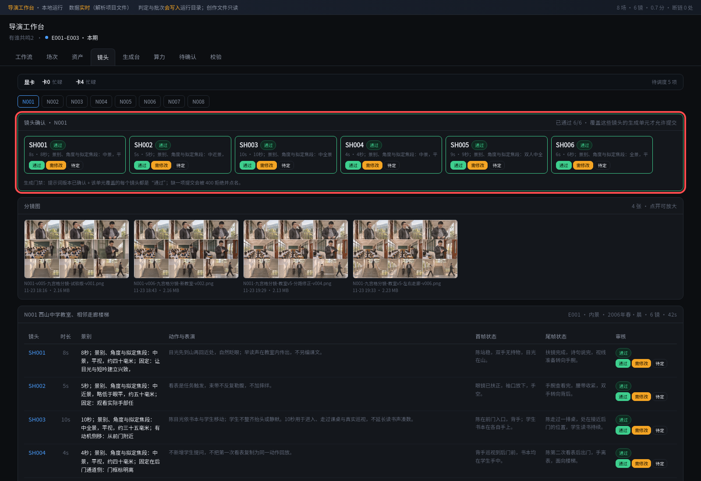

# M1 改了什么 · 页面在哪看

- 写于：2026-11-24 15:20
- 当前 HEAD：`23ab2a5`（**不是**我上一轮说的 `881b60e`；后面多了 4 个不是我做的提交）
- 我的 M1 提交：`1544bd0`、`58980f2`、`b2819b9`、`9bbf7fe`、`839ca04`、`7e8933b`、`881b60e`
- 我的改动范围：`app/server.py`、`app/approvals.py`、`app/sched.py`、`app/vjobs.py`、`app/comfywatch.py`、`app/gpus.py`、`app/scenes.py`、`app/build_ui.py`、`app/ui_src/template.html`、`app/test_*.py`、`docs/`
- 不是我的：`98f1345` 音色资产、`68f4a8d` v011 接续声明、`576a31d` 哈希变量修复、`23ab2a5` 生成台「全部次数」



> 截图是 2026-11-24 15:20 的 8790 实际页面：顶部 `8 场 · 6 镜 · 0.7 分`、`E001–E003 · 本期`；镜头页顶部红框处是新增的「镜头确认 · N001」条，6 个镜头各有「通过 / 需修改 / 待定」。截图时 6 镜均已通过、5 条任务待调度/在跑。

## 1 你能直接看到的 6 处

| # | 位置 | 之前 | 现在 | 怎么确认 |
|---|---|---|---|---|
| 1 | 每个页面顶部 | `0 场 · 0 镜 · 0.0 分`、按钮「无分集数据」 | `8 场 · 6 镜 · 0.7 分`、`E001–E003 · 本期` | 打开 `/`，看页头 |
| 2 | **镜头** tab 顶部 | 没有逐镜审核入口；审核列在表格最右，容易看不到 | 新增「镜头确认 · N001」6 张卡，每张有通过/需修改/待定 | 点「镜头」，看红框位置 |
| 3 | **待确认** / 阶段详情 | 点「确认」返回 400 `未知单元类型 artifact`（或 string scope 400） | 返回 200，写 `制作运行/approvals.jsonl`；旧 5 条确认已迁移 | 看 `/api/approvals`；**不要误点**，会真实落账 |
| 4 | **生成台** 提交 | 只看提示词确认；`force` 可绕；批次先入队后写 | 文件版本 + 单元覆盖的每个镜头都要通过；无 `force`；批次先写后入队 | 未过镜头时 POST `/api/gen/submit` 返回 400 并点名 SH001 |
| 5 | **算力** / 顶栏 | 排队中的 B 显示「生成中」；有队列的卡显示「可加载」 | 排队显示「排队」；卡有队列就「忙碌」；顶栏统计视频+图片 | 看算力页卡 0/4 与待调度数 |
| 6 | 任务失败/重启 | A 失败仍记 done，B 会跑；重启 resume 丢 after | A 失败 → B cancelled；resume 保留依赖边；终态不覆盖 | `python3 app/test_jobs_m1.py`、`test_review_fixes.py` |

## 2 看不到的原因（按可能性）

1. **你开的是旧 tab**：8790 是单页应用，不会自己重载；我 15:16 才把「镜头确认」条加到页面。刷新一次（`Cmd/Ctrl+Shift+R`）再看「镜头」。
2. **改动不在「工作流」页**：工作流/场次/资产页主要是数据层和少量文案；最显眼的新入口在 **镜头** 和 **待确认**。
3. **后来的 4 个提交改变了界面**：音色资产、v011 接续、全部次数是另一个会话/提交做的，不是我上一轮说的内容；所以你现在看到的页面和我汇报的“M1 界面”不完全一样。
4. **你没有点到会真实写账本的按钮**：确认/通过按钮不会改变页面外观，除非重新加载数据；数据变化在 `制作运行/approvals.jsonl`。

## 3 30 秒验收

```bash
# 1) 页头数据
curl -s http://127.0.0.1:8790/api/overview | python3 -m json.tool | head -20

# 2) 审批账本（现在应有 file/shot/batch 记录）
curl -s http://127.0.0.1:8790/api/approvals | python3 -c \
  "import json,sys; d=json.load(sys.stdin); print(d['summary']['total'], d['summary']['by_kind'])"

# 3) 旧接口已停用
curl -s -o /dev/null -w '%{http_code}\n' -X POST http://127.0.0.1:8790/api/execute \
  -H 'Content-Type: application/json' -d '{}'      # 410

# 4) 回归
python3 app/test_all.py                            # 40 通过 / 0 失败 / 2 跳过
```

浏览器里只看 3 个地方：

1. 页头：`8 场 · 6 镜 · 0.7 分`、`E001–E003 · 本期`。
2. 镜头：顶部「镜头确认 · N001」，6 张卡。
3. 待确认/阶段详情：点任意草稿「确认」，看是否 200、`approvals.jsonl` 是否多一行（**会真实落账**）。

## 4 当前状态提醒

- 15:29 已按导演授权重启 8790；重启前 5 条任务都有 promptId，重启后卡 0/4 都在，任务记录保留。
- 当前审批：19 条（file 8 / shot 6 / batch 2），说明镜头门禁和批次记录已经在真实使用。
- 当前 HEAD 上的音色/接续/全部次数不是我的改动；如果你要我继续，我会基于 `23ab2a5` 做，不覆盖这些提交，也不打断在跑任务。
