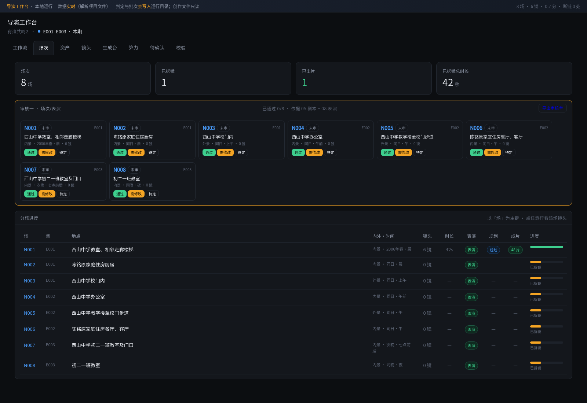
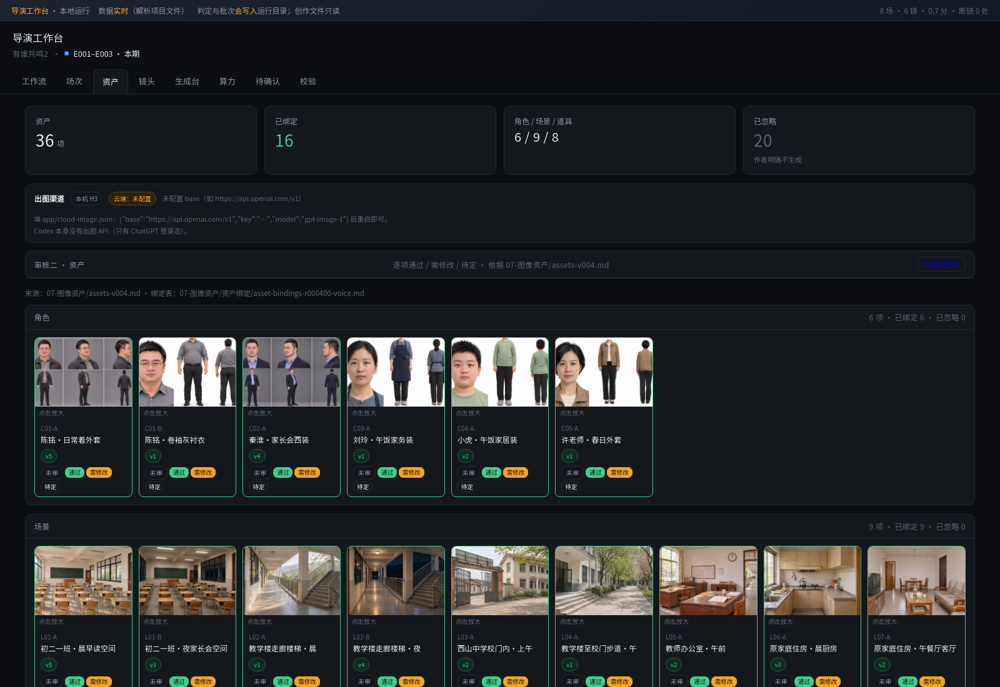

# M2 改动说明 · 场次/资产审核 + 待确认统一

- 日期：2026-11-24
- 提交：`133a0a1`（M2 代码/测试）、`dfa2130`（截图）
- 基线：`23ab2a5`（包含 M1 + 别人后续的音色/接续/全部次数）
- 状态：**已上线**。15:29 按导演授权立即重启 8790；5 条在途任务全部保留 promptId 并对回 ComfyUI 队列（卡 0/4 都在），M2 API 已生效。

## 1 这轮加了什么

| # | 位置 | 之前 | 现在 |
|---|---|---|---|
| 1 | **场次**页顶部 | 只有分场进度表 | 新增「审核一 · 场次/表演」：8 场卡片，逐场通过/需修改/待定；依据 05 剧本 + 08 表演；顶部显示 `已通过 x/8` 与「导出审核单」 |
| 2 | **资产**页 | 只有绑定图和忽略状态 | 每张资产卡新增逐项通过/需修改/待定；顶部「审核二 · 资产」与「导出审核单」 |
| 3 | **待确认**页 | 草稿按登记表 `status` 列出，确认后仍显示；本地状态读旧 `确认状态.json` | 草稿排除“本地已确认”；新增「本地已确认（登记仍为草稿）」；本地状态全部来自 `approvals.jsonl` |
| 4 | **导出** | `/api/export` 只导旧 gate 1/2/3 | 新增 `/api/reviews/export`：按 场次/资产/镜头/文件/挑片/批次 导出审批记录 + 意见 + 版本 + SHA + stale |
| 5 | 后端 | `/api/scenes`、`/api/assets` 无审批字段 | 每个场/资产带 `approval` 与 `reviewPath`；`/api/stages` 的 `local` 改为 approvals 口径 |
| 6 | 失效 | 场/资产改动不影响审批 | 场次绑 05 剧本 SHA、资产绑 07 `assets-v4.md` SHA；文件变 → stale |





> 截图来自正式项目数据：场次 0/8 已审、资产 36 项；按钮和导出入口已在页面上。正式 8790 已于 15:29 重启，`/api/scenes` 已带 `reviewPath`/`approval`，`/api/reviews/export` 返回 200。

## 2 测试

```text
python3 app/test_m2_reviews.py   # 8 通过 / 0 失败
python3 app/test_all.py          # 41 通过 / 0 失败 / 2 跳过
```

`test_m2_reviews.py` 覆盖：
- `/api/scenes` 带 `reviewPath`；POST 场次审批后可见；改 05 文件 → stale；
- `/api/assets` 带 `reviewPath`；POST 资产审批后可见；改 07 文件 → stale；
- `/api/stages` 的本地状态来自 approvals（不是旧 `确认状态.json`）；
- `/api/reviews/export` 含场次/资产/意见。

## 3 当前边界

- 场次审批绑 **05 剧本整文件**；08 表演变化目前不单独触发场次 stale（M3 可拆双文件绑定）。
- 资产审批绑 **07 `assets-v4.md` 整文件**；单个绑图变化不单独 stale（M3 可拆单资产路径）。
- 待确认页只统一了“文件级审批”；场/资产审批是独立记录，不替代文件级确认。
- 08/05/07 既有文件仍未改；审批只写 `制作运行/approvals.jsonl`。

## 4 为什么你之前“没看到”

- 我 M1 的改动主要是数据/门禁/测试，页面只有页头和镜头条；你 14:28 打开的旧 tab 不会自动刷新。
- 15:16 后我才把「镜头确认」条放到镜头页；15:20 截图才证明它已生效。
- 15:24 这轮 M2 又把场次/资产审核面板加上；但 8790 还有 5 条任务在跑，我**没有重启**，所以新 API 还没全部生效。
- 现阶段请在刷新后看：
  1. 顶部 `8 场 · 6 镜 · 0.7 分`；
  2. **场次**页顶部「审核一 · 场次/表演」；
  3. **资产**页顶部「审核二 · 资产」；
  4. **待确认**页的「本地已确认」区。
- 15:29 已手动重启（导演授权“可以重启”）：重启前 5 条任务都有 `promptId`，重启后 `reconcile` 按队列对回，卡 0/4 都在；没有重新提交、没有丢任务记录。
- 重启后验证：`/api/health` 200、`/api/scenes` 8 场带 `reviewPath`、`/api/assets` 36 项带 `reviewPath`、`/api/reviews/export` 200、`/api/backend` 仍 2 实例 5 任务。
