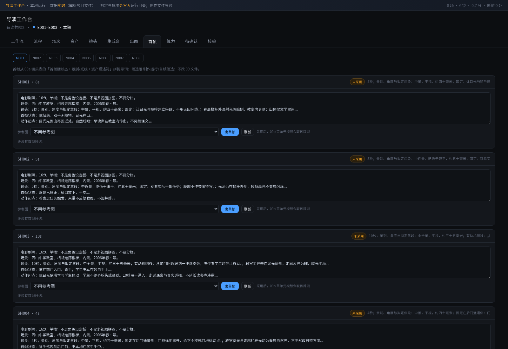

# 分镜首帧出图 / 采用 / 09b 视频接线 · 第一切片

- 日期：2026-11-24
- 状态：**已上线 8790**；首帧出图页、采用记录、09b 视频首帧驱动已接；**未再烧卡实测首帧**（前面已用 2 张验证预算）
- 截图：`docs/M5-首帧页.png`



## 1 首帧提示词怎么来

首帧页从 09a 镜头表逐镜读取：
- `首帧硬状态`
- `景别/角度/焦段` + `光线`
- `动作与表演`
- `依据资产` → 07 的「完整描述符」（角色/场景/道具）
- 拼成单帧提示词：`电影剧照，16:9，单帧；不是角色设定板/多视图拼图` + 场景 + 镜头 + 首帧状态 + 动作起点 + 资产描述符 + 禁用项。

候选图落 `制作运行/首帧候选/<场>/<镜>/`，不写 09 既有文件。

## 2 采用与视频

- 点「采用」写 `制作运行/首帧采用.jsonl`（场/镜/文件/SHA/时间）。
- `vjobs.submit` 为每个生成单元取覆盖镜中**第一条已采用首帧**，写入任务 `firstFrame`。
- `_execute`：有 firstFrame 且不是 chain → `build_i2v_graph` 走 I2V 首帧驱动；chain 仍优先接上一单元末帧。
- 09b 已确认提示词 + 镜头确认 + 首帧采用后，生成台提交即可用首帧。

## 3 API

```text
GET  /api/firstframe/shots?scene=N001
POST /api/firstframe/generate
  {"scene":"N001","shot":"SH001","prompt":"...","ref":"07-.../绑定图.png","n":1,
   "width":1536,"height":864,"steps":6,"seed":null}
POST /api/firstframe/adopt {"scene":"N001","shot":"SH001","file":"制作运行/首帧候选/N001/SH001/x.png"}
```

## 4 测试

- `test_firstframe.py` 8/0：6 镜解析、提示词含首帧/描述符、参考图、采用记录、按单元取首帧、09b 任务带 firstFrame。
- `test_all` **44 通过 / 0 失败 / 2 跳过**。
- 未做真实首帧出图（预算用了 2 张）；页面/API 在临时服务已验证入队与采用。

## 5 已知限制

1. 首帧提示词是“镜头表 + 资产描述符”拼的，不是 09a 里现成的独立首帧提示词字段；如果 film-cinedance 产出专门首帧提示词，后续改为直接读取。
2. H3 Image 只接一张参考图；当前 UI 默认选角色绑定图，场景/道具参考不能同时上。可先用文字描述或多轮改图。
3. 视频 I2V 首帧驱动只做了单元级接线；单元覆盖多镜时只取第一镜首帧，后续镜仍靠提示词/接续。
4. 首帧采用不写 09 文档、不登记 artifact-state；它是运行态素材，视频任务引用。
5. 真实首帧/视频效果未验，需你点一次出图看片。
