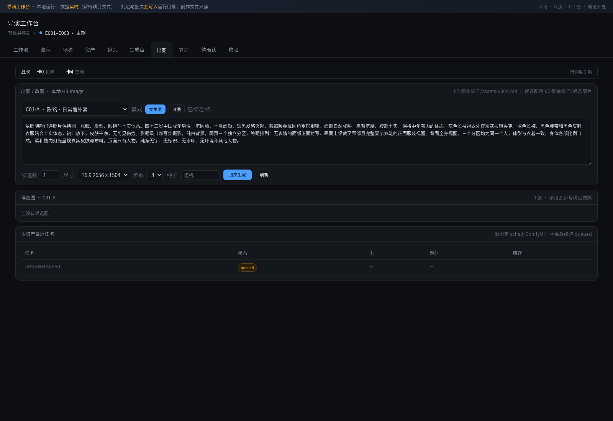

# 出图 / 改图（本地 H3 Image）· 第一切片

- 日期：2026-11-24
- 提交：本文件随 `M4` 代码提交
- 状态：**已上线 8790**；T2I 与改图各实测 1 张成功，测试图已按“用完即撤”删除



## 1 页面能力

- 入口：顶部导航「出图」。
- 资产来源：`07-图像资产/assets-vNNN.md` 的「完整中文生成提示词」；回退 `00-项目管理/工作台/project.json` 的 slot prompt。
- **文生图 T2I**：选资产 → 提示词可改 → 候选数 1–4 → 16:9 尺寸（2656×1504 / 2048×1152 / 1536×864）→ 6/8 步 → 可选 seed → 提交。
- **改图 Edit**：选资产 → 模式「改图」→ 选底图（当前绑定或已有候选）→ 写“保留什么/只改什么” → 提交；H3 Image 用 `image_1`，输出单帧。
- 候选图落 `07-图像资产/候选图片/<资产>/`；采用时**新增**绑定快照、更新 `00-项目管理/工作台/project.json`（候选/绑定版本/history/revision/bindingManifest），并**新增**下一版 `07-图像资产/assets-vNNN.md`（草稿待确认，不改旧版）。
- 任务走 `sched`/ComfyUI；`imgjobs` 已 JSON 落盘 + queued 重启续跑。

## 2 API

```text
GET  /api/img/candidates?asset=C01-A
POST /api/img/generate
  {"asset":"C01-A","mode":"t2i|edit","prompt":"...","ref":"07-.../底图.png",
   "n":1,"width":1536,"height":864,"steps":6,"seed":null}
POST /api/img/adopt   {"asset":"C01-A","file":"07-.../候选.png"}
GET  /api/img/jobs
```

- `generate` 先过 `imagegen.preflight`（提示词、参考图存在、宽高 32 倍数）。
- `adopt` 写 `图片采用.jsonl` + 新绑定快照 + `project.json` + 新 `assets-vNNN`；新资产文档同时由流程页登记为 07 草稿，确认后生效。
- 采用已闭环：绑定快照 + project.json + 新 assets 版本；旧版不动。

## 3 实测

| 项 | 结果 |
|---|---|
| T2I C01-A 1536×864 / 6 步 | **成功**，225.7s，卡4，PNG 2656×1504（模型输出尺寸按工作流） |
| 改图 C01-A 1536×864 / 6 步，底图=首张候选 | **成功**，263.2s，卡4；夹克改深蓝，但模型仍保留三分区版式（提示词“单帧”未完全服从） |
| 测试图 | 2 张已删除（用完即撤），`imgjobs` 记录已清；候选区当前为空 |
| 回归 | `test_all` **43 通过 / 0 失败 / 2 跳过**；`test_image` 12/0（含采用闭环） |

## 4 已知限制

1. 改图“输出单帧”不稳定：参考图是三分区角色板时，模型会沿用拼图版式；后续在提示词/工作流层加“单帧、非拼图”强约束或先裁单视图。
2. 新 `assets-vNNN` 是**草稿**，需要在「流程」页确认后才成为 `已确认-当前`；`project.json` 已先更新绑定版本，两者语义不同。
3. `imgjobs` 的 **running** 任务重启不自动收图；queued 会续跑。图片一般 4 分钟内完成，风险低于视频，但仍需补。
4. 没有“从本机上传底图”入口；改图底图目前从当前绑定/已有候选中选。
5. 真实生成仍受 GPU 争用影响；一次只验 1–2 张。
