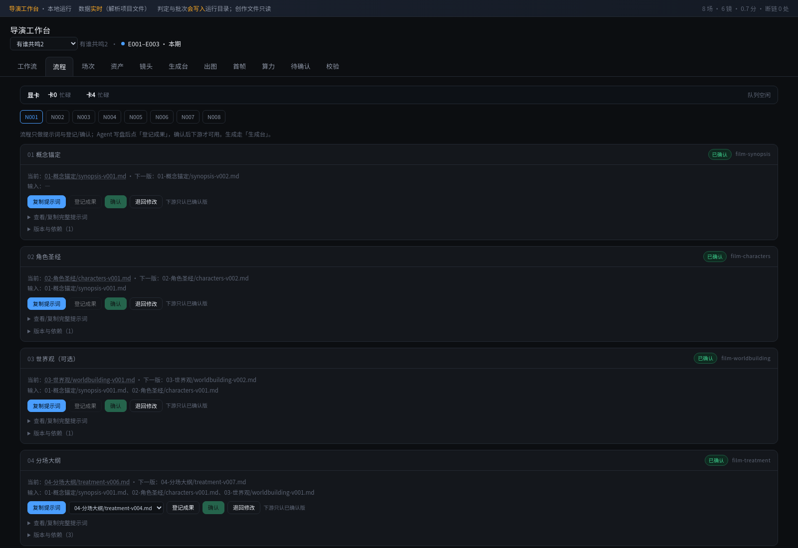

# 流程页交互加固 + 退回 / 修订 / 重接受

- 日期：2026-11-24
- 入口：8790「流程」
- 截图：`docs/M7-流程交互.png`

## 1 本次加的交互

- **文件选择器**：每张卡列出未登记的 `newFiles`，登记时明确传 `path`；不再由服务端“猜最高版本”。
- **版本与依赖**：每张卡展示 vNNN / 状态 / sha256 前 10 位 / `depends_on`；只读。
- **退回修改**：写 `制作运行/flow-returns.jsonl`，卡上显示“上次退回：原因 · 时间”；不直接改 artifact-state。
- **可选阶段跳过**：03 / 06 在无成果时可“跳过”，写 `制作运行/flow-skips.jsonl`；已有成果时拒绝。
- **批量登记 / 批量确认**：当前场次逐卡执行，返回成功/失败条数；失败项保留。
- **确认二次确认**：确认前弹出“会成为当前版本，下游可能待复核”。
- **05b 时长复核**：05 的双产出拆成 05 与 05b 两张卡。
- **已过期状态**：`已过期-禁止使用` 显示为 `superseded`，不再灰 `unknown`。

## 2 退回 → 改新版 → 重接受（本次实测）

在 `_2` 测试项目上实际执行：

1. 01 v001、02 v001 已确认。
2. 对 01 点「退回修改」，原因“退回 01 后改 v002”；`flow-returns.jsonl` 写入。
3. 写 `01-概念锚定/synopsis-v002.md`，登记并确认。
4. `artifact_guard` 自动把依赖旧 01 的下游全部标为 **已过期-禁止使用**：
   `02, 03, 04, 05, 05b, 06, 07, 08, 09a, 09b`（10 条）。
5. 写 `02-角色圣经/characters-v002.md`，登记并确认；02 回到 `已确认-当前`，02 v001 留底为过期。
6. 测试项目 artifact-state 变为 **13 条**（含 01/02 新旧版）；正式项目无变化。

结论：**退回后修改再接受是通的**；registry 会自动使下游过期，必须再逐级改新版/确认才能恢复“当前”。当前流程页会把过期显示为 `superseded`，但不会自动阻止你在生成台用旧版——下一步应加“过期版本禁止生成”的硬门禁。

## 3 自动化测试

- `test_revision.py` **11/0**：基线两版确认 → 退回记录 → 01 v002 确认 → 01 v001 历史替代 → 02 自动过期 → 02 v002 确认 → 02 v001 留底 → 03 可跳过 / 有成果不可跳过。
- `test_all` **49/0/2**；`test_flow` 11/0；`test_projects` 7/0；`test_revision` 11/0；`test_m1_acceptance` 80/0/2。

## 4 还没做

1. ~~过期版本进入生成~~ → 已在 M8 加硬门禁（视频/首帧/出图）。
2. 版本 diff 视图（只显示 sha/依赖，没有逐行 diff）。
3. Agent 自动执行入口：M8 已加任务单 + 可配置命令；未配置命令时仍需人工执行。
4. 空项目初始化入口、项目健康度、手工添加项目路径。
5. 09b 依赖正则只认 `minimax-h3-vNNN.md`，不认 `minimax-h3-ref2va-vNNN.md`。
